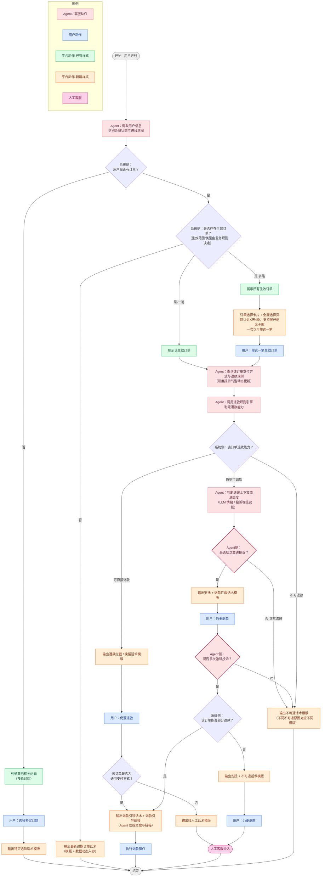

# 会员退款客服 Agent 流程图

> 基于业务侧「会员退款流程图」重构为 **Agent 视角** 的流程。
> 核心思路：Agent 通过**调用工具取数**、**调用规则引擎判定退款能力**、**用 LLM 判断用户激进态度**，再结合**业务规则**决策，最终只负责"给话术 / 给退款引导链接 / 给安抚文案"，不直接改账务。
> 所有话术模版、生效订单范围规则、是否可退/是否激进退款规则，均由**业务侧提供**，Agent 只做编排与动态入参填充。

---

## 1. Agent 职责边界

Agent **做**：
- 调取用户/会员信息，识别进线意图与会员状态。
- 按业务规则拉取"生效订单"并组织成卡片供用户**单选**（生效订单的范围/类型由业务规则决定，如"近 90 天生效中"）。
- 查询所选订单的支付方式与退款规则（配合进度提示气泡）。
- 调用退款规则引擎判定退款能力（可直接退 / 原则可退 / 不可退）。
- 用 LLM 识别用户进线上下文的**激进态度**（正常 / 初次激进 / 多次激进）。
- 结合业务规则决定是否"激进退款"，并输出对应**话术模版 + 动态入参**。
- 可退时：仅输出**退款引导话术 + 退款引导链接**。
- 坚决不退时：输出**安抚 + 不可退话术**。
- 兜底升级：输出转人工话术并转人工客服。

Agent **不做**：实际扣款/退款账务操作（由退款引导链接背后的平台能力或人工完成）。

## 2. Agent 能力 / 工具清单

| 工具 / 能力 | 类型 | 输入 | 输出 | 规则/模版来源 |
| --- | --- | --- | --- | --- |
| 用户会员信息查询 | 取数工具 | userId | 会员状态、账户画像 | 平台 |
| 生效订单查询 | 取数工具 | userId + 订单范围规则 | 生效订单列表 | 业务规则（范围/类型） |
| 订单详情/支付方式/退款规则查询 | 取数工具 | orderId | 支付方式、退款窗口、退款能力 | 平台 |
| 退款规则引擎 | 规则判定 | 订单 + 用户上下文 | 可直接退 / 原则可退 / 不可退 | 业务规则 |
| 激进态度识别 | LLM 判定 | 进线上下文会话 | 正常 / 初次激进 / 多次激进 | 业务阈值 |
| 话术生成 | 文案编排 | 模版ID + 动态入参 | 对话气泡文案 | 业务模版库 |
| 退款引导链接生成 | 文案/链接 | orderId | 退款引导话术 + 链接 | 平台 |
| 转人工 | 升级 | 会话上下文 | 人工接管 | 平台 |

## 3. Agent 流程图

## 4. 关键决策节点说明

1. **用户是否有订单 / 是否有生效订单（系统侧）**：纯取数 + 规则判定。生效订单的"范围与类型"（如近 90 天、生效中）由业务规则配置，Agent 不写死。
2. **订单数量分流**：0 笔生效 → 输出最新过期订单话术；1 笔 → 直接展示；多笔 → 卡片单选（默认 4 条，超出走全屏选择器），**一次只允许选一笔**。
3. **退款能力判定（系统侧退款规则引擎）**：输出三态——
   - `可直接退款`：先挽留，用户坚持后按支付方式分流。
   - `原则可退款`：进入**激进态度判断**（即业务侧的"激进退款"策略）。
   - `不可退款`：直接走安抚 + 不可退话术（坚决不退）。
4. **激进态度判断（Agent 侧 LLM）**：
   - `正常沟通` → 维持不可退话术（原则可退但不满足激进退款条件）。
   - `初次激进` → 先安抚 + 退款拦截；用户仍坚持再升级判断。
   - `多次激进` → 结合"能否部分退款"决定给退款引导链接或安抚 + 转人工。
5. **退款执行**：Agent 永远只给"退款引导话术 + 链接"，实际退款由链接背后能力或人工完成。
6. **转人工兜底**：非通用支付方式、或多次激进且不可部分退但用户仍坚持时转人工。

## 5. 话术模版注入点（均业务提供模版 + 动态入参）

| 节点 | 模版类型 | 动态入参示例 |
| --- | --- | --- |
| 输出特定选项话术 | 常见问题应答 | 问题类型 |
| 输出最新过期订单话术 | 过期告知 | 订单名、到期时间 |
| 退款拦截 / 挽留话术 | 挽留 | 会员权益、剩余时长 |
| 安抚 + 退款拦截话术 | 情绪安抚 + 挽留 | 投诉要点 |
| 退款引导话术 + 链接 | 引导 | 退款金额、退款链接 |
| 不可退 / 安抚 + 不可退话术 | 不可退说明 | 不可退原因（不同原因不同模版） |
| 转人工话术 | 升级 | 排队/工单信息 |

## 6. 边界兜底场景（对应业务图中的黄色便签）

- **多轮对话中用户不点任何选项、继续在聊天框提问**：Agent 保留会话上下文，重新做意图识别；命中退款意图则回到对应订单分支，未命中则走通用问答，连续兜底失败后转人工。
- **用户直接输入"全部订单我都要退款"**：Agent 说明"一次仅能处理一笔"，引导用户通过卡片单选逐笔处理；或登记全部订单后按规则逐笔走退款判定流程，避免一次性批量误退。
